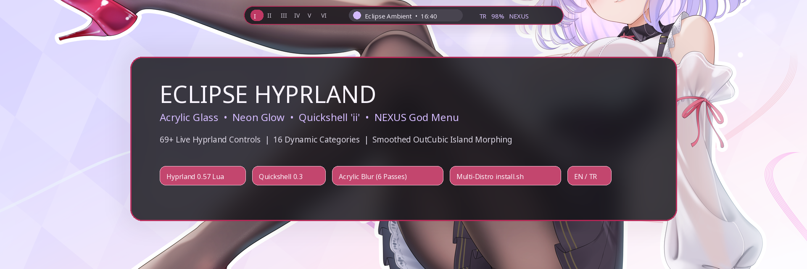
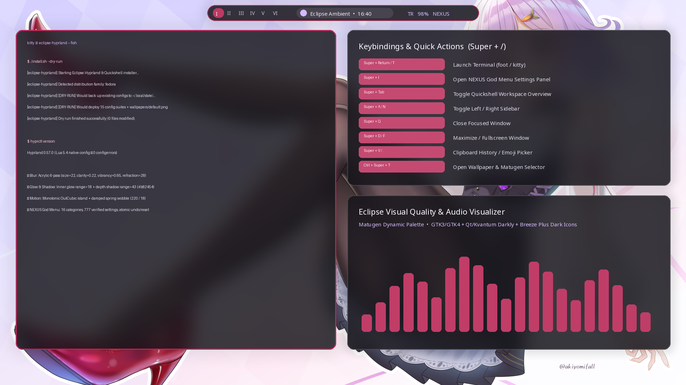
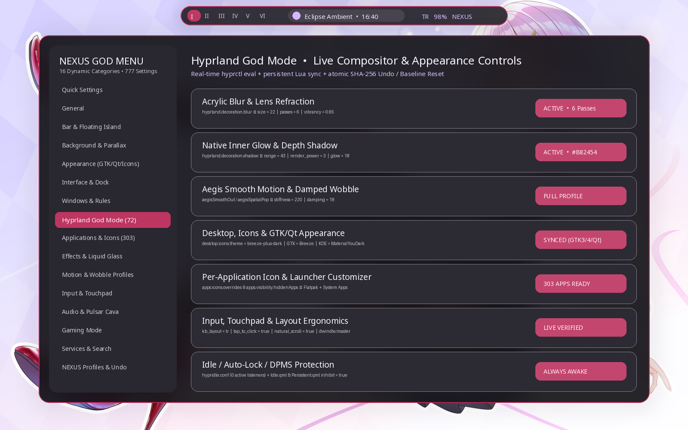
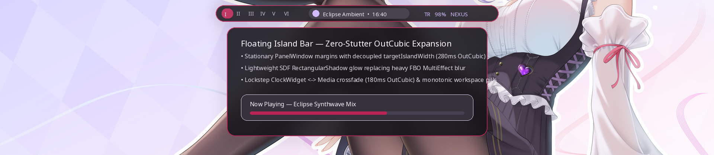

<div align="center">

# 🌑 Eclipse Hyprland Dotfiles

**Acrylic Glass • Neon Inner Glow • Smoothed OutCubic Motion • Quickshell (`ii`) • NEXUS God Menu**

[-b82454?style=for-the-badge&logo=linux&logoColor=white)](https://hyprland.org/)
[](https://quickshell.outfoxxed.me/)
[](#nexus-god-menu)
[](#-installation--kurulum)
[](./LICENSE)

[**🇬🇧 English**](#-english-guide) • [**🇹🇷 Türkçe Rehber**](#-türkçe-rehber)



</div>

---

## 📸 Showcase Gallery / Ekran Görüntüleri

| Desktop & Acrylic Overview | NEXUS God Menu (16 Dynamic Categories) |
| :---: | :---: |
|  |  |

<div align="center">

### Floating Island Top Bar — Zero-Stutter `OutCubic` Morphing


</div>

---

## 🇬🇧 English Guide

### ✨ Key Highlights

| Feature | Description |
| :--- | :--- |
| **🔮 Eclipse Acrylic Blur & Neon Glow** | 6-pass Acrylic glass blur (`size = 22`, `clarity = 0.22`, `vibrancy = 0.65`, `refraction = 28`, `bulb = 52`, `aberration = 0.03`) paired with native inner window glow (`range = 18`, `#b82454`) and deep multi-power drop shadows (`range = 43`, `render_power = 3`). |
| **⚡ Butter-Smooth Animations** | Stationary `PanelWindow` margins with decoupled `targetIslandWidth` (`280ms OutCubic`), lightweight SDF `RectangularShadow` glow, monotonic `OutCubic` workspace & popup transitions, and damped spring window wobble (`stiffness = 220`, `damping = 18`). |
| **🎛️ NEXUS God Menu (`settings.qml`)** | Automatic 6-layer Category Engine managing **16 dynamic categories** and **777 verified settings** (69+ live `hyprctl` compositor controls, GTK3/GTK4/Qt/KDE theme & icon sync, per-application `.desktop` icon & visibility customizer, profiles, and SHA-256 preflight undo/reset). |
| **🛡️ Always-Awake Ergonomics** | Auto-lock, automatic DPMS screen blanking, and automatic idle suspend are disabled out of the box (`hypridle.conf` has 0 active idle listeners; `Idle.qml` & `Persistent.qml` default to `inhibit: true`). Lock or sleep only when you explicitly press `Super + L` / `Super + Shift + L`. |
| **🎨 Unified Matugen & Toolkit Theming** | Bundled 5K default wallpaper (`wallpapers/default.png`) with synchronized GTK 3, GTK 4, Qt/KDE (`MaterialYouDark` + `Darkly`/`Kvantum`), `breeze-plus-dark` icons, `kitty`, `fuzzel`, `wlogout`, `starship`, `cava`, and `fish`. |

### 📁 Repository Layout

```text
eclipse-hyprland/
├── install.sh                      # Multi-distro installer (Fedora / Arch / Debian-Ubuntu) with backup & --dry-run
├── README.md                       # Bilingual EN/TR documentation & keybinding reference
├── LICENSE                         # MIT License
├── wallpapers/
│   └── default.png                 # Bundled 5120x3840 default wallpaper
├── assets/
│   └── screenshots/                # Showcase screenshots
│       ├── banner-wallpaper.png
│       ├── desktop-overview.png
│       ├── nexus-god-menu.png
│       └── top-bar-island.png
└── config/                         # Deployed into $XDG_CONFIG_HOME (~/.config)
    ├── hypr/                       # Native Lua Hyprland 0.57+ config, custom visual/motion presets, hypridle & hyprlock
    ├── quickshell/ii/              # Quickshell "ii" desktop shell + NEXUS God Menu settings suite
    ├── illogical-impulse/          # Default shell & NEXUS config.json (auto-adapted to target $HOME)
    ├── matugen/                    # Dynamic Material You palette templates
    ├── kitty/                      # GPU terminal configuration
    ├── fuzzel/                     # Fallback launcher & clipboard/emoji picker styling
    ├── wlogout/                    # Session power menu layout & styling
    ├── gtk-3.0/ & gtk-4.0/         # Dark GTK 3/4 themes, CSS colors & window button layout
    ├── Kvantum/ & kdeglobals       # Qt/KDE Darkly & MaterialYouDark theme configuration
    ├── fontconfig/                 # Font rendering & family rules
    ├── cava/                       # Audio visualizer shaders & spectrum config
    ├── fish/                       # Interactive Fish shell config + Starship prompt integration
    └── starship.toml               # Minimalist Starship prompt
```

### 🚀 Installation

```bash
git clone https://github.com/sudoivonx/eclipse-hyprland.git
cd eclipse-hyprland

# Preview every action safely without touching any files:
./install.sh --dry-run

# Full interactive installation (detects Fedora dnf / Arch pacman / Ubuntu-Debian apt, backs up old configs, deploys dotfiles & default wallpaper):
./install.sh

# Or deploy configurations & default wallpaper only (skipping system package manager):
./install.sh --skip-packages --yes
```

#### Installer Options (`./install.sh --help`)
- `--dry-run`: Simulate package detection, backups, and file deployment with zero filesystem changes.
- `--skip-packages`: Skip system package manager installation and deploy `config/*` + `wallpapers/default.png` directly.
- `--no-backup`: Skip creating a pre-install backup in `~/.local/state/eclipse-hyprland/backups/<timestamp>/`.
- `-y, --yes`: Run non-interactively without confirmation prompts.

#### Rollback / Restore
Before overwriting any existing directory in `~/.config`, `install.sh` automatically snapshots your previous configuration into:
```text
~/.local/state/eclipse-hyprland/backups/<YYYYMMDD-HHMMSS>/
```
To roll back, copy the desired folders from that backup directory back into `~/.config/` and run `hyprctl reload`.

---

## 🇹🇷 Türkçe Rehber

### ✨ Öne Çıkan Özellikler

| Özellik | Açıklama |
| :--- | :--- |
| **🔮 Eclipse Akrilik Blur & Neon Glow** | 6 geçişli Akrilik cam bulanıklığı (`size = 22`, `clarity = 0.22`, `vibrancy = 0.65`, `refraction = 28`, `bulb = 52`, `aberration = 0.03`), doğal iç pencere parlaması (`glow.range = 18`, `#b82454`) ve derin pencere gölgeleri (`shadow.range = 43`, `render_power = 3`). |
| **⚡ Pürüzsüz Animasyonlar** | Medya çalarken genişleyen üst bar adasında (`FloatingIslandContent.qml` & `Bar.qml`) milimlik takılmaları ortadan kaldıran sabit `PanelWindow` kenar boşlukları + ayrıştırılmış `targetIslandWidth` (`280ms OutCubic`), hafif SDF `RectangularShadow` ve sönümlü yay pencere esnemesi (`stiffness = 220`, `damping = 18`). |
| **🎛️ NEXUS God Menu (`settings.qml`)** | Tam otomatik kategori motoruyla üretilen **16 dinamik kategori** ve **777 doğrulanmış ayar**: 69+ canlı `hyprctl` kontrolü, GTK3/GTK4/Qt/KDE tema ve sistem ikon senkronizasyonu, uygulama bazlı `.desktop` ikon ve başlatıcı görünürlük özelleştiricisi, profil yönetimi ve SHA-256 korumalı geri alma (`undo`) / sıfırlama (`reset`). |
| **🛡️ Otomatik Kilit ve Uyku Kapalı** | Sistem siz manuel olarak kilitlemedikçe (`Super + L`) veya uykuya almadıkça (`Super + Shift + L`) ekranı otomatik kilitlemez veya uykuya geçmez (`hypridle.conf` içinde aktif `listener` yoktur; `Idle.qml` ve `Persistent.qml` varsayılan olarak `inhibit: true` ayarlıdır). |
| **🖼️ Varsayılan Duvar Kağıdı & Tema** | Mevcut kurulumun tüm ince ayarları ve 5K varsayılan duvar kağıdı (`wallpapers/default.png`) kutudan çıktığı gibi varsayılan olarak gelir; `install.sh` kurulum sırasında tüm yolları kendi `$HOME` dizininize otomatik uyarlar. |

### 🚀 Kurulum (Türkçe)

```bash
git clone https://github.com/sudoivonx/eclipse-hyprland.git
cd eclipse-hyprland

# Hiçbir dosyaya dokunmadan kurulum adımlarını simüle et:
./install.sh --dry-run

# Tam kurulum (Fedora dnf / Arch pacman / Ubuntu-Debian apt algılar, mevcut ayarları yedekler, tüm dosyaları ve varsayılan duvar kağıdını kurar):
./install.sh

# Yalnızca yapılandırma dosyalarını ve varsayılan duvar kağıdını kur (paket yöneticisini atla):
./install.sh --skip-packages --yes
```

> **Klavye Düzeni Notu:** `config/hypr/hyprland/general.lua` içinde varsayılan klavye düzeni Türkçe (`kb_layout = "tr"`) olarak ayarlıdır. NEXUS God Menu → **Hyprland → Input Keyboard** üzerinden veya `general.lua` içinden anında değiştirebilirsiniz.

---

## ⌨️ Keybindings Reference / Kısayollar Tablosu

Derived directly from `config/hypr/hyprland/keybinds.lua` and `config/hypr/custom/keybinds.lua`:

### 🖥️ Shell, NEXUS & Panels / Kabuk ve Paneller
| Shortcut / Kısayol | Action (EN) | İşlev (TR) |
| :--- | :--- | :--- |
| `Super + I` | Open **NEXUS God Menu** Settings (`settings.qml`) | **NEXUS God Menu** ayar panelini aç |
| `Super + Tab` | Toggle Workspace Overview & App Search | Çalışma alanı genel görünümünü ve aramayı aç/kapat |
| `Super + A` / `Super + B` / `Super + O` | Toggle Left Sidebar (AI / Launcher / Tools) | Sol kenar çubuğunu aç/kapat |
| `Super + N` | Toggle Right Sidebar (Quick Toggles / Notifications) | Sağ kenar çubuğunu (hızlı ayarlar / bildirimler) aç/kapat |
| `Super + /` or `Super + Shift + .` | Toggle Keybindings Cheatsheet | Kısayol rehberini (Cheatsheet) aç/kapat |
| `Super + M` | Toggle Media Controls Popup | Medya kontrol panelini aç/kapat |
| `Super + G` | Toggle Desktop Widget Overlay | Masaüstü widget katmanını aç/kapat |
| `Super + J` | Toggle Top Bar Visibility | Üst barı gizle/göster |
| `Super + K` | Toggle On-Screen Keyboard (OSK) | Ekran klavyesini aç/kapat |
| `Super + V` | Clipboard History (`cliphist`) | Pano geçmişini aç |
| `Super + .` | Emoji Picker | Emoji seçiciyi aç |
| `Ctrl + Super + T` | Open Wallpaper & Matugen Palette Selector | Duvar kağıdı ve renk paleti seçiciyi aç |
| `Ctrl + Super + Alt + T` | Pick Random Wallpaper | Rastgele duvar kağıdı seç |
| `Ctrl + Super + Shift + D` | Toggle Light / Dark Theme Mode | Açık / Koyu tema kipini değiştir |
| `Ctrl + Super + P` | Cycle Panel Family (`ii` ↔ `waffle`) | Panel tasarım ailesini değiştir (`ii` ↔ `waffle`) |
| `Ctrl + Super + R` | Hot-Restart Quickshell Widgets | Quickshell arayüzünü yeniden başlat |
| `Ctrl + Super + Alt + /` | Edit Custom Keybinds (`custom/keybinds.lua`) | Özel kısayol dosyasını düzenle |

### 🪟 Window & Workspace Management / Pencere ve Çalışma Alanları
| Shortcut / Kısayol | Action (EN) | İşlev (TR) |
| :--- | :--- | :--- |
| `Super + Q` | Close Focused Window | Aktif pencereyi kapat |
| `Super + Shift + Alt + Q` | Force-Kill Window (`hyprctl kill`) | Pencereyi zorla sonlandır |
| `Super + D` | Toggle Maximize Window | Pencereyi ekranı kapla / eski haline döndür |
| `Super + F` | Toggle Fullscreen | Tam ekran aç/kapat |
| `Super + Alt + Space` | Toggle Floating / Tiling | Pencereyi yüzer (float) / döşeme kipine al |
| `Super + P` | Pin Floating Window Across Workspaces | Pencereyi tüm çalışma alanlarına sabitle |
| `Super + Arrow Keys` | Focus Window Left / Right / Up / Down | Yön tuşlarıyla pencere odağını değiştir |
| `Super + Shift + Arrow Keys` | Move Window Left / Right / Up / Down | Pencereyi seçilen yöne taşı |
| `Super + ;` / `Super + '` | Decrease / Increase Split Ratio (`-0.1` / `+0.1`) | Bölünme oranını azalt / artır |
| `Super + Left Drag` / `Super + Right Drag` | Move / Resize Window with Mouse | Fareyle pencereyi taşı / boyutlandır |
| `Super + 1..0` | Switch to Workspace 1..10 | 1..10 numaralı çalışma alanına geç |
| `Super + Alt + 1..0` | Send Window to Workspace 1..10 | Pencereyi 1..10 numaralı çalışma alanına gönder |
| `Ctrl + Super + Left / Right` | Previous / Next Workspace | Önceki / sonraki çalışma alanına geç |
| `Super + S` | Toggle Scratchpad (`special:special`) | Özel çalışma alanını (Scratchpad) aç/kapat |
| `Super + Alt + S` | Move Window to Scratchpad | Pencereyi özel çalışma alanına gönder |

### 🚀 Applications, Capture & Session / Uygulamalar, Ekran Yakalama ve Oturum
| Shortcut / Kısayol | Action (EN) | İşlev (TR) |
| :--- | :--- | :--- |
| `Super + Return` / `Super + T` | Launch Terminal (`foot` / `kitty`) | Terminal başlat (`foot` / `kitty`) |
| `Super + E` | Launch File Manager (`dolphin` / `nautilus`) | Dosya yöneticisini başlat |
| `Super + W` | Launch Web Browser | Web tarayıcısını başlat |
| `Super + C` | Launch Code Editor | Kod editörünü başlat |
| `Super + X` | Launch Text Editor | Metin düzenleyiciyi başlat |
| `Ctrl + Super + V` | Launch Volume Mixer (`pavucontrol`) | Ses karıştırıcısını aç |
| `Ctrl + Shift + Esc` | Launch System Monitor / Task Manager | Görev yöneticisini aç |
| `Super + Shift + S` | Region Screenshot / Snip | Bölgesel ekran görüntüsü al |
| `Print` / `Ctrl + Print` | Fullscreen Screenshot (Clipboard / File) | Tam ekran görüntüsü al (Pano / Dosya) |
| `Super + Shift + C` | Hex Color Picker (`hyprpicker -a`) | Ekrandan renk kodu kopyala (`#RRGGBB`) |
| `Super + Shift + X` | Region OCR Text Extraction | Ekrandaki yazıyı panoya kopyala (OCR) |
| `Super + Shift + R` | Record Screen Region (`record.sh`) | Bölgesel ekran kaydı başlat/durdur |
| `Super + L` | Lock Session (`loginctl lock-session`) | Ekranı manuel kilitle |
| `Super + Shift + L` | Suspend System (`systemctl suspend`) | Sistemi manuel uykuya al |
| `Ctrl + Alt + Delete` | Toggle Session Power Menu | Oturum kapatma menüsünü aç |

---

## 📄 License / Lisans

Released under the [MIT License](./LICENSE). Crafted for the Hyprland & Quickshell community by [@sudoivonx](https://github.com/sudoivonx).
